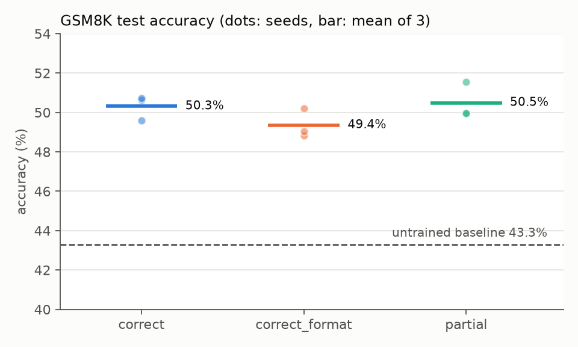
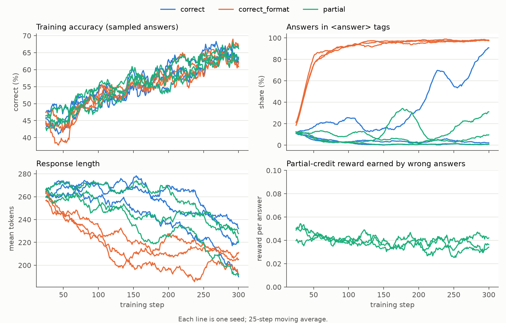

# Reward Design for RL Fine-Tuning of Small Language Models

How does the choice of reward change what a small language model learns during
reinforcement learning? This project fine-tunes **Qwen2.5-0.5B-Instruct** with
**GRPO** (with LoRA) on **GSM8K** math word problems, on a single laptop GPU
(RTX 4060, 8 GB), and compares three reward designs:

| Variant | Reward |
|---|---|
| `correct` | 1 if the final answer is correct, else 0 |
| `correct_format` | correctness + 0.2 bonus for giving the answer in `<answer></answer>` tags |
| `partial` | 1 if correct, up to 0.5 for answers within 50% of the true value |

Measured: test accuracy, format compliance, response length, and examples of
reward hacking.

**Status (Oct 2026):** all 9 runs (3 reward variants × 3 seeds) are trained and
evaluated; results below. A short write-up is in progress.

## Setup

```bash
python -m venv .venv
.venv\Scripts\activate
pip install torch --index-url https://download.pytorch.org/whl/cu130
pip install -r requirements.txt
```

## Usage

```bash
# Baseline accuracy of the untrained model on the GSM8K test set
python evaluate.py --out results/baseline.json

# GRPO training (300 steps, ~3.2 h on an RTX 4060 Laptop GPU)
python train_grpo.py --variant correct --seed 0

# Evaluate the trained adapter
python evaluate.py --adapter runs/correct_s0 --out results/correct_s0.json

# Full experiment: 3 reward variants x 3 seeds, each trained then evaluated (~3.5 h per run).
# Finished runs are skipped and an interrupted run resumes from its latest checkpoint
# (saved every 50 steps), so it is safe to stop with Ctrl+C and re-run later.
python run_all.py

# Comparison table, reward-hacking checks and figures
python analyze.py
```

Training settings: LoRA r=16 on all attention and MLP projections, learning rate 1e-5,
8 prompts × 8 completions per step, completions capped at 384 tokens, no KL penalty.

## Results

Full GSM8K test set (1319 problems), zero-shot with the system prompt in `data.py`,
greedy decoding, max 512 new tokens. Trained rows are mean ± standard deviation over 3 seeds.

| Model | Accuracy | `<answer>` tags | `\boxed{}` | Near misses | Truncated | Mean tokens |
|---|---|---|---|---|---|---|
| Qwen2.5-0.5B-Instruct (baseline) | 43.3% | 7.4% | 62.1% | 18.2% | 3.5% | 291 |
| + GRPO, `correct` | 50.3% ± 0.6% | 30.1% ± 51.5% | 68.3% ± 51.6% | 16.7% ± 0.3% | 1.4% ± 0.5% | 228 ± 19 |
| + GRPO, `correct_format` | 49.4% ± 0.7% | 99.1% ± 0.6% | 3.2% ± 3.7% | 17.2% ± 0.3% | 1.0% ± 0.5% | 218 ± 11 |
| + GRPO, `partial` | 50.5% ± 0.9% | 8.4% ± 7.7% | 89.9% ± 8.3% | 17.9% ± 0.5% | 1.0% ± 0.2% | 228 ± 20 |

*Near misses*: wrong answers within 50% of the true value, i.e. answers the `partial`
reward pays for.





**Findings**

- **Every reward design helps, and by about the same amount.** Accuracy rises 6–7
  points over the untrained model. The gaps between designs (at most 1.1 points) are
  about the size of the seed-to-seed spread, so none is clearly better after 300 steps.
  The format bonus may cost about a point (49.4% vs 50.3%); 3 seeds cannot confirm it.
- **Without a format reward, format compliance depends on the seed.** With
  correctness-only reward, the three seeds ended at 0.3%, 89.5% and 0.5% use of the
  requested `<answer>` tags; the others mostly fell back to the model's habit of
  `\boxed{}`. A 0.2 format bonus made every seed adopt the tags: over 80% of training
  answers within 50 steps, and 98–100% on the test set.
- **No reward hacking from partial credit.** The partial-credit reward earned by wrong
  answers stayed at 0.03–0.05 per answer and drifted down during training, and the
  test-set near-miss rate did not rise (17.9% vs 18.2% for the baseline). Correctness
  improved at the same pace as under the other rewards.
- **Answers got shorter.** Mean length fell from 291 to 218–228 tokens (22–25%), and
  truncated answers fell from 3.5% to about 1%.

Numbers here are comparable with each other, not with published scores: Qwen reports
49.6% for Qwen2.5-0.5B-Instruct under its own evaluation setup, which uses a different
prompt and answer extraction.

## License

MIT
